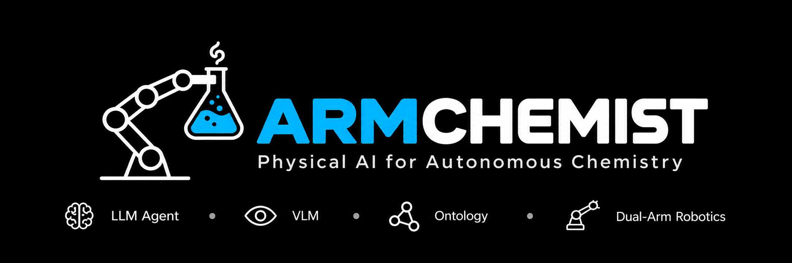
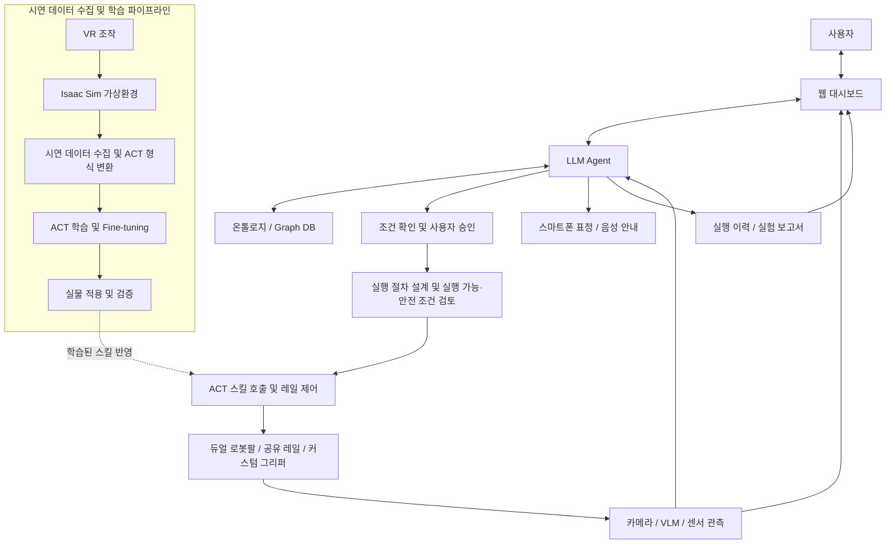
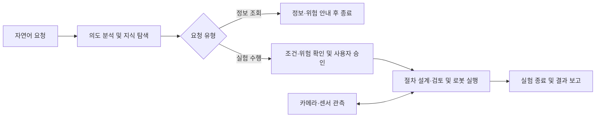
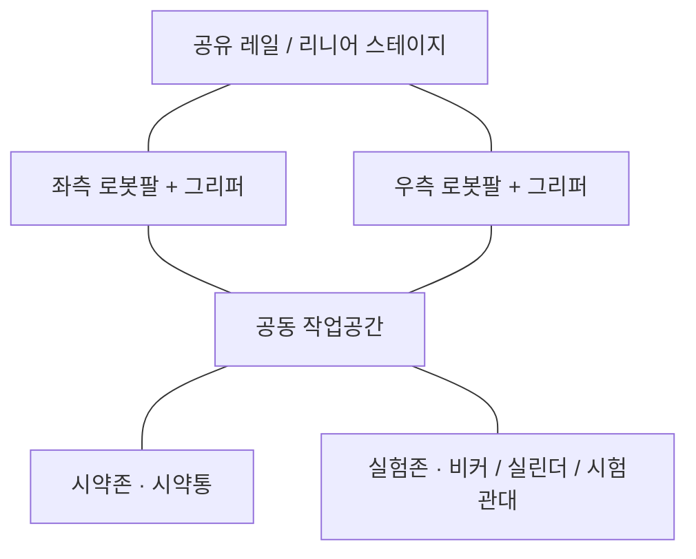
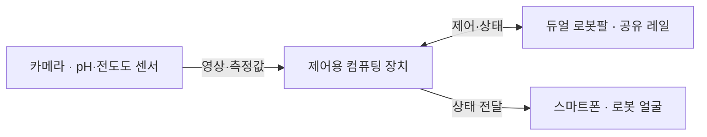
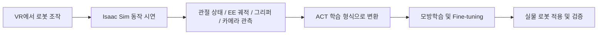
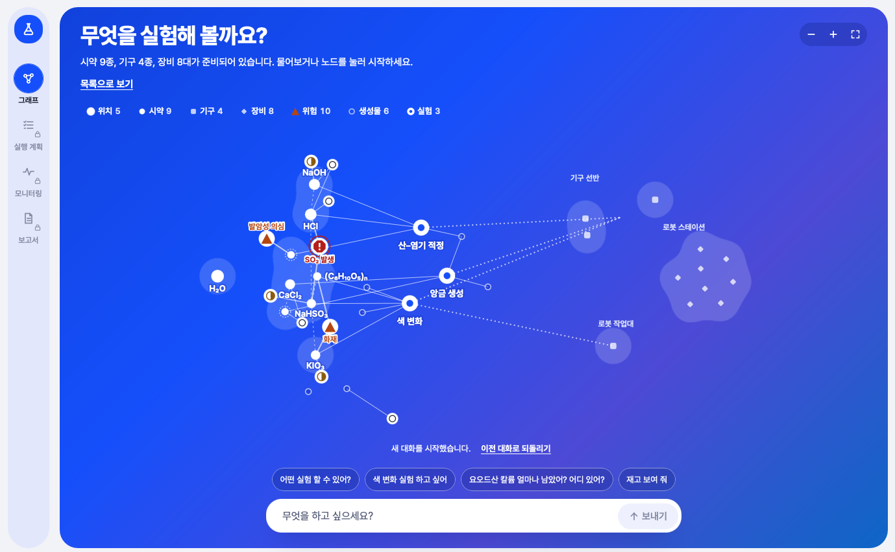
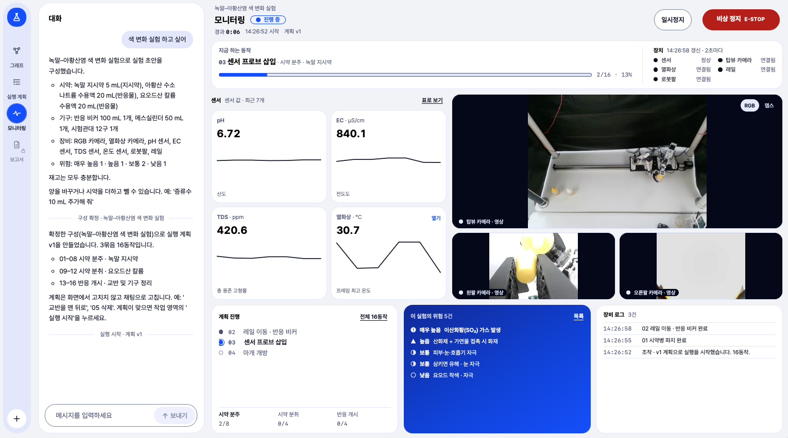
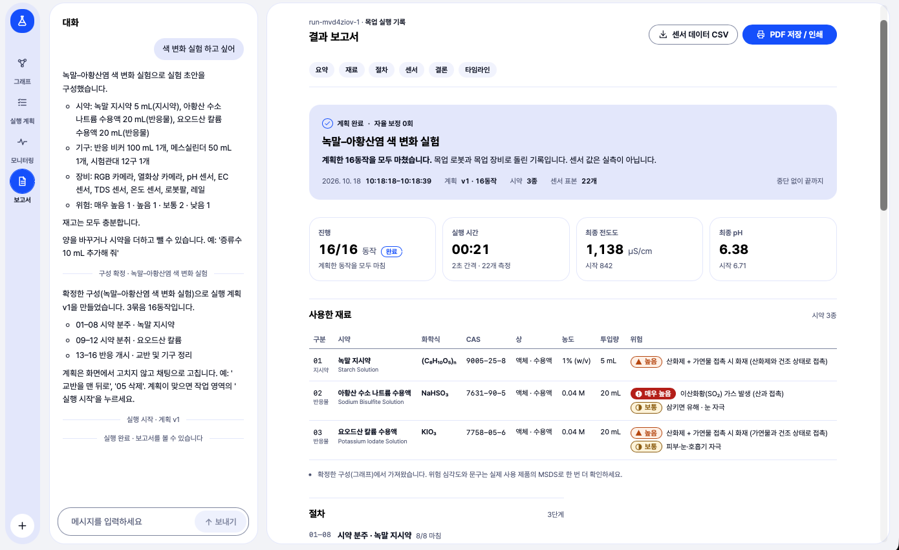

  
  <h1>ARMChemist</h1>
  
<strong>Physical AI for Autonomous Chemistry</strong>

  
자연어 요청부터 지식 탐색, 실험 계획, 로봇 조작과 기록까지 연결하는 화학실험 보조 시스템

  

    <a href="#1-프로젝트-개요">프로젝트 개요</a> ·
    <a href="#2-팀원-소개">팀원 소개</a> ·
    <a href="#3-시스템-아키텍처">시스템 아키텍처</a> ·
    <a href="#4-시연">시연</a> ·
    <a href="#5-핵심-소스코드">핵심 소스코드</a>
  

  

    
    
    
  

---

## 1. 프로젝트 개요

> **자연어 요청 → 지식 탐색 → 실험 계획 → 듀얼 로봇팔 수행 → 기록**까지 하나의 흐름으로 연결하는 Physical AI 화학실험 보조 시스템

### 개발 배경

- **위험 노출:** 시약통 잡기, 뚜껑 열기, 용액 붓기 등 반복 조작에서 유해 물질에 직접 노출됩니다.
- **사고 부담:** 기구 파손, 용액 유출, 장비 충돌에 계속 주의해야 합니다.
- **수기 기록:** 실험 과정과 센서값을 손으로 기록하는 부담이 큽니다.

→ 개별 장비 자동화를 넘어, 연구자가 **목표 설정과 판단**에 집중하도록 전 과정을 연결합니다.

### 핵심 특징

- **자연어 상호작용:** 정보 조회와 실험 수행을 구분하고, 대화로 조건을 구체화
- **지식 기반 계획:** 온톨로지·Graph DB로 실험 조건과 위험 정보 검토
- **LLM + ACT 역할 분담:** LLM Agent는 순서·실행 관리, ACT 정책은 학습된 조작 수행
- **양팔 협업 + 공유 레일:** 주작업/보조작업 분담, 접근 범위 확장
- **관측 기반 실행:** 액션 전후 관측을 확인해 다음 작업 진행 여부 판단
- **가상환경 데이터 수집:** Isaac Sim + VR로 사전 검증 및 시연 데이터 수집

### 주요 기능

| 기능 | 설명 |
|---|---|
| 실험실 정보 조회 | 시약·기구, 시약 특성과 위험성, 실험 조건 질의응답 |
| 대화형 조건 설정 | 목표·시약·용량 확인, 누락 정보 보완 |
| 승인과 실행 계획 | 조건·위험 안내 → 사용자 승인 → 스킬 호출 순서 설계 |
| 듀얼 로봇팔 조작 | 파지·이동·유지·뚜껑 조작·붓기·센서 투입 등 스킬 조합 |
| 관측 및 관제 | 카메라·센서·로봇 상태·진행 상황을 웹에서 확인 |
| 상태 전달 | 스마트폰 표정과 음성으로 상태·주의 상황 전달 |
| 기록 및 보고서 | 실행 이력·센서 관측 정리, PDF/CSV 제공 |

### 기대효과 및 활용 분야

| 기대효과 | 활용 분야 |
|---|---|
| 반복 조작·수기 기록 부담 완화 | 대학·교육기관의 로봇/화학실험 자동화 교육 |
| 유해 물질·위험 환경 직접 노출 감소 | 연구실 반복 조작, pH·전도도 측정 보조 |
| 실행 이력·관측 데이터 기반 추적·비교 | 웹 기반 원격 관제, 스마트 실험실 |
| 양팔 협업·스킬 조합으로 보조 작업 확장 | 양팔 조작·모방학습 시연 데이터 수집 플랫폼 |
| 가상환경 시연으로 기구 파손·충돌 부담 완화 | |

---

## 2. 팀원 소개

|  |  |  |  |  |
|:---:|:---:|:---:|:---:|:---:|
| **멘티 1** | **멘티 2** | **멘티 3** | **멘티 4** | **멘티 5** |
| 팀장 프론트엔드 | 하드웨어·로봇 구동 백엔드 | 프론트엔드 데이터 수집 | 온톨로지 구축 화학 도메인 지식 | 백엔드 |

---

## 3. 시스템 아키텍처

### 3-1. 전체 시스템 구성도

> 실험 서비스와 별도로, 디지털 트윈·VR 파이프라인이 로봇 스킬의 데이터 수집과 사전 검증을 담당합니다.

**사용자 요청 처리 흐름**

> 조건은 대화로 보완 → 승인 후 절차 설계 및 실행·안전 조건 검토 → 실행 중 동작 전후 관측으로 진행 여부와 이상 대응 판단

### 3-2. AI Agent 및 온톨로지

| 계층 | 역할 |
|---|---|
| **LLM Agent** | 요청 의도 구분 · 지식 탐색 · 누락 조건 확인 · 승인 후 작업 단위 분해 · ACT 스킬/양팔/레일 순서 결정 · 관측 확인 및 오류 대응 |
| **온톨로지 / Graph DB** | 시약·기구·조건·위험 정보의 관계 탐색 → 조건 검토, 지시약 선택, 위험 안내, 작업 계획에 활용 |

- 정보 조회는 답변으로 종료, 실험 수행은 **조건 확인 → 사용자 승인 → 실행** 순으로 진행합니다.
- 로봇 조작은 제한된 실행 도구와 학습된 스킬 호출로만 연결됩니다.

### 3-3. 하드웨어 구성 및 ACT 기반 로봇 실행

#### 하드웨어 구성도

**작업대 구성**

**제어 및 관측 연결**

> 두 로봇팔이 공유 레일로 시약존·실험존에 접근해 공동 작업공간에서 협업합니다. 관측값은 제어용 컴퓨팅 장치로 전달되고, 스마트폰은 상태를 표정으로 표시합니다.

#### 구성 요소별 역할

| 구성 | 역할 |
|---|---|
| 듀얼 로봇팔 | 물체 파지·유지·이동, 뚜껑 조작, 붓기 등 수행 |
| 공유 레일 | 시약존과 실험존에 접근할 수 있도록 작업 범위 확장 |
| 커스텀 그리퍼 | 실험기구의 형태와 작업에 맞춘 파지 지원 |
| 카메라·센서 | 작업공간과 실험 상태 관측 |
| 제어용 컴퓨팅 장치 | Agent·정책 실행 및 장비 통신·제어 |
| 스마트폰 | 표정을 통한 로봇 상태 전달과 사용자 상호작용 |

#### ACT 실행과 양팔 협업

- **ACT (Action Chunking with Transformers):** 사람 시연 데이터로 학습한 모방학습 정책. 카메라 관측과 관절 상태를 입력받아 행동 시퀀스를 생성합니다.
- **역할 분담:** LLM Agent는 스킬·순서·양팔/레일 계획을, ACT는 선택된 스킬의 동작을 담당합니다.
- **양팔 협업 예:** 한쪽 팔이 시약통을 유지하고 다른 팔이 뚜껑을 조작합니다. 센서 투입, 용액 붓기, 시험관대 이동, 실린더 배치도 같은 방식의 스킬 조합입니다.

### 3-4. 센서 및 실시간 관제

- **관측:** 카메라·VLM은 시각 상태를, pH·전도도 센서는 수치 상태를 확인하고 기구 식별·위치 정보와 함께 활용합니다.
- **실행 관리:** 관측값에 타임스탬프를 부여하고, 각 액션 직전 최신 관측을 재확인하며 동작 후 결과로 진행 여부를 판단합니다.
- **웹 대시보드:** 대화, 조건 확인·승인, 카메라·센서, 로봇 상태, 진행 상황, 결과 이력을 한 화면에 연결합니다.
- **보고서:** 종료 후 실행 기록과 관측 데이터를 정리합니다. 이상 징후 알림은 사전 위험 검토와 함께 사용자의 판단을 돕습니다.

### 3-5. Isaac Sim + VR 데이터 수집

- Isaac Sim 디지털 트윈은 실제 로봇의 URDF·운동학 특성, 듀얼 로봇팔·공유 레일, 작업공간과 기구 배치를 반영합니다.
- 접근과 동작을 사전 검토하고, VR로 파지·이동·붓기 시연을 수집해 반복적인 실물 시연 부담을 줄입니다.
- 활용 범위는 로봇 조작과 작업공간 검토 중심이며, 학습된 정책은 실물 적용과 검증으로 연결합니다.

### 3-6. 스마트폰 로봇 인터페이스

- 스마트폰 화면이 로봇의 **얼굴** 역할을 하며, 눈과 표정으로 대기·요청 처리·실험 수행·완료·오류/위험 상태를 전달합니다.
- 주의가 필요한 상황에는 표정 변화와 음성 안내를 함께 사용합니다.
- 웹 대시보드가 상세 정보를 제공한다면, 스마트폰 얼굴은 **로봇 주변 사용자가 상태를 빠르게 파악**하도록 돕습니다.

---

## 4. 시연

### 작품 소개 영상

### 로봇

### 웹 UI

| 화면 | 기능 | 설명 |
|---|---|---|
|  | **초기 화면** | 시약·기구·장비·위험 관계를 그래프로 탐색하고, 추천 질문이나 채팅으로 실험을 시작 |
|  | **실험 구성** | 대화로 시약·기구·장비 구성, 위험 등급, 재고를 확인하고 구성 확정 |
|  | **모니터링** | 진행 단계, pH·EC·TDS·온도 센서값, 카메라 영상, 장비 로그, 위험 정보를 실시간 확인하고 일시정지·비상정지 |
|  | **결과 보고서** | 실행 요약, 사용 재료·위험, 절차, 센서 변화(pH·전도도), 타임라인을 정리하고 센서 CSV·PDF로 저장 |

---

## 5. 핵심 소스코드

각 기능의 개발 저장소에서 실제 소스코드를 가져와 아래와 같이 구성했습니다. 원본 모듈의 내부 구조와 의존성 정의는 유지했습니다. **이 저장소는 소스 취합본이며, 모듈 간 전체 연동 및 실물 장비 실행은 검증하지 않았습니다.** 웹 UI에는 원본의 mock/http 어댑터가 함께 포함되어 있습니다.

| 구성 | 코드 위치 | 주요 구현 | 원본 저장소 |
|---|---|---|---|
| AI Agent | [src/backend/agent](src/backend/agent) | 자연어 요청 처리, 작업 계획, 런타임, 장비 어댑터, API | [armchemist_agent](https://github.com/armchemist/armchemist_agent) |
| 온톨로지 | [ArmChemist_GraphDB.owl](src/backend/ontology/ArmChemist_GraphDB.owl) | 기존 화학 도메인 온톨로지 | 기존 파일 유지 |
| 웹 대시보드 | [src/frontend](src/frontend) | React·TypeScript 채팅, 지식 그래프, 실행 모니터링, 보고서 | [NewUI](https://github.com/armchemist/NewUI) |
| 센서·레일 서버 | [src/pi_sensor](src/pi_sensor) | pH·전도도·열화상 관측, 레일 제어, 중앙 서버 | [PiSensorServer](https://github.com/armchemist/PiSensorServer) |
| 로봇 제어 서버 | [src/robot](src/robot) | 로봇 장치 API, 카메라 스트림, 장비 설정 | [PiRobotControl](https://github.com/armchemist/PiRobotControl) |
| 스마트폰 얼굴 | [src/robot_face](src/robot_face) | Flutter 표정·카메라 화면, 서버 연결 | [humanoid_haed_app](https://github.com/armchemist/humanoid_haed_app) |
| 모방학습 | [src/imitation_learning](src/imitation_learning) | 시연 데이터 기반 학습 스크립트와 학습 의존성 | [ImitationLearning](https://github.com/armchemist/ImitationLearning) |
| 시뮬레이션 | [src/simulation](src/simulation) | Blender 배치 생성, Gazebo 모델·월드, ROS 2 launch | [SimulationEnv](https://github.com/armchemist/SimulationEnv) |

#### 주요 코드 진입점

- **Agent:** [api.py](src/backend/agent/armchemist/api.py), [planning.py](src/backend/agent/armchemist/planning.py), [runtime.py](src/backend/agent/armchemist/runtime.py)
- **웹:** [App.tsx](src/frontend/src/app/App.tsx), [어댑터](src/frontend/src/adapters), [그래프 렌더링](src/frontend/src/graph/canvas), [보고서](src/frontend/src/report)
- **센서:** [중앙 서버](src/pi_sensor/central/main.py), [센서 서버](src/pi_sensor/server/main.py), [Arduino 펌웨어](src/pi_sensor/sensors/arduino_sensors/arduino_sensors.ino)
- **로봇:** [제어 API](src/robot/server/main.py), [카메라](src/robot/server/hardware/camera.py)
- **얼굴 앱:** [main.dart](src/robot_face/lib/main.dart), [face_screen.dart](src/robot_face/lib/face_screen.dart)
- **학습:** [omx_learning.py](src/imitation_learning/omx_learning.py)
- **시뮬레이션:** [배치 생성](src/simulation/blender/scripts/build_layout.py), [ROS 2 실행](src/simulation/ros2/simulation_env_bringup/launch/lab_bench.launch.py)

각 모듈의 설정과 실행 방법은 해당 폴더의 README를 참고하세요. 시뮬레이션 취합본은 **Gazebo/ROS 2 기반**이며, 상단의 Isaac Sim·VR 설명과는 구분됩니다. 체크포인트와 대용량 학습 데이터는 포함하지 않습니다.

가져온 커밋, 파일 수, 제외 항목은 [소스 취합 기록](docs/source-imports.json)에 남겼습니다. 원본 `.git`, 개발 에이전트 설정, UI 재작성 프롬프트·시안, Blender 원본 `.blend`, 노트북은 제외했습니다. 비밀값은 포함하지 않고 `.env.example`만 보존합니다.

---

**2026 한이음 드림업 공모전 | ARMChemist**

