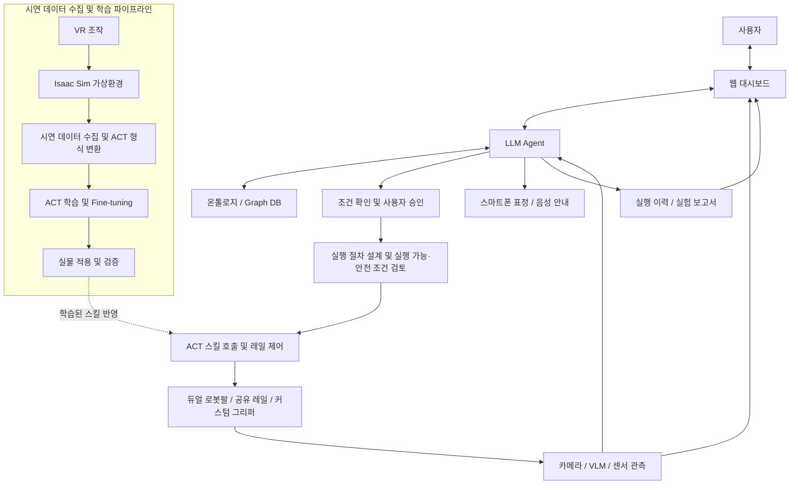
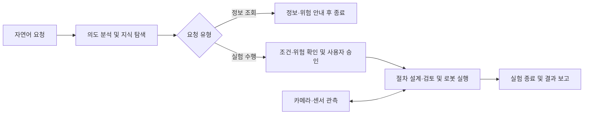
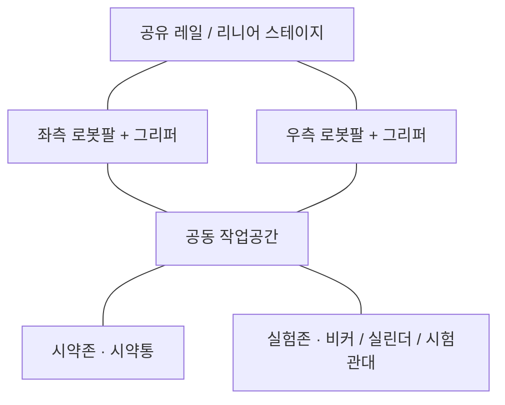
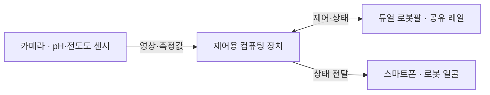
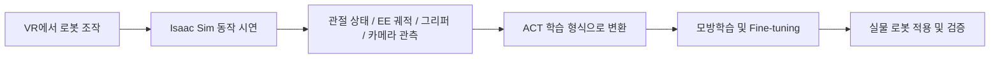
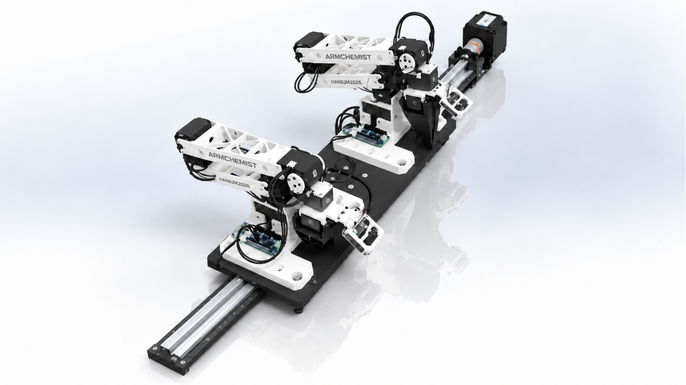

  
  <h1>ARMChemist</h1>
  
<strong>Physical AI for Autonomous Chemistry</strong>

  
자연어 요청부터 지식 탐색, 실험 계획, 로봇 조작과 기록까지 연결하는 화학실험 보조 시스템

  

    <a href="#1-프로젝트-개요">프로젝트 개요</a> ·
    <a href="#2-팀원-소개">팀원 소개</a> ·
    <a href="#3-시스템-아키텍처">시스템 아키텍처</a> ·
    <a href="#4-시연">시연</a> ·
    <a href="#5-핵심-소스코드">핵심 소스코드</a>
  

  

    
    
    
  

---

## 1. 프로젝트 개요

### 프로젝트 소개

**ARMChemist는 사용자의 자연어 요청을 이해하고, 화학 지식을 탐색하거나 실험 절차를 계획한 뒤 듀얼 로봇팔로 실험을 수행하는 Physical AI 기반 화학실험 보조 시스템입니다.**

LLM Agent가 온톨로지와 Graph DB에서 실험 지식과 위험 정보를 탐색하고, 사용자가 조건을 확인하고 승인하면 학습된 ACT 스킬과 공유 레일 제어를 조합해 실험을 수행합니다. 실행 중에는 카메라와 센서로 상태를 확인하며, 웹 대시보드와 스마트폰 표정으로 진행 상황을 전달합니다. 종료 후에는 실행 이력과 관측 데이터를 정리해 실험 기록을 제공합니다.

연구자는 실험 목표와 조건을 제시하고 실행을 승인합니다. 시스템은 준비된 장비·시약·학습된 동작 범위에서 반복 조작과 관측·기록을 보조합니다.

### 개발 배경

화학실험에는 시약통 잡기, 뚜껑 열기, 용액 붓기, 센서 투입과 같은 반복 조작이 필요합니다. 이 과정에서 연구자는 유해 물질과 위험 환경에 직접 노출될 수 있으며, 실험기구 파손이나 용액 유출, 장비 충돌에도 주의를 기울여야 합니다. 실험 과정과 센서값을 수기로 기록하는 일도 부담으로 이어집니다.

ARMChemist는 개별 장비의 자동화를 넘어 자연어 요청, 실험 지식 탐색, 계획, 로봇 조작, 관측과 기록을 하나의 흐름으로 연결합니다. 이를 통해 연구자가 반복 작업에 들이는 부담과 직접 노출을 줄이고, 실험의 목표 설정과 판단에 집중하도록 돕습니다.

### 핵심 특징

- **자연어 기반 상호작용:** 실험실 정보 조회와 실험 수행 요청을 구분하고, 대화로 필요한 조건을 구체화합니다.
- **지식 기반 계획:** 온톨로지와 Graph DB의 관계 정보를 활용해 실험 조건과 위험 정보를 검토합니다.
- **LLM + ACT 역할 분담:** LLM Agent가 작업 순서와 실행을 관리하고, ACT 정책이 학습된 로봇 조작을 수행합니다.
- **양팔 협업과 작업공간 확장:** 듀얼 로봇팔이 주작업과 보조작업을 나누고, 공유 레일로 접근 범위를 넓힙니다.
- **관측에 기반한 실행 관리:** 액션 전 최신 관측과 동작 결과를 확인해 다음 작업의 진행 여부를 판단합니다.
- **가상환경 기반 데이터 수집:** Isaac Sim과 VR을 활용해 로봇 동작을 사전 검증하고 모방학습용 시연 데이터를 수집합니다.

### 주요 기능

| 기능 | 설명 |
|---|---|
| 실험실 정보 조회 | 사용 가능한 시약·기구, 시약 특성과 위험성, 실험 조건에 관한 질문에 답변합니다. |
| 대화형 실험 조건 설정 | 실험 목표와 시약·용량 등의 조건을 확인하고, 누락된 정보를 대화로 보완합니다. |
| 사용자 승인과 실행 계획 | 조건과 위험 정보를 안내하고 사용자 승인을 받은 뒤, 실행 절차와 스킬 호출 순서를 설계합니다. |
| 듀얼 로봇팔 조작 | 파지·이동·유지·뚜껑 조작·붓기·센서 투입 등의 학습된 스킬을 조합합니다. |
| 관측 및 실시간 관제 | 카메라 영상, 센서값, 로봇 상태와 실험 진행 상황을 웹에서 확인합니다. |
| 상태 전달 및 알림 | 스마트폰 표정과 음성 안내로 작업 상태와 주의가 필요한 상황을 전달합니다. |
| 실험 기록 및 보고서 | 실행 이력과 센서 관측을 정리하고, PDF/CSV로 결과를 확인하고 활용합니다. |

### 기대효과 및 활용 분야

**기대효과**

- 반복적인 실험 조작과 수기 기록에 드는 부담 완화
- 유해 물질과 위험 환경에 대한 연구자의 직접 노출 감소
- 실행 이력과 관측 데이터를 통한 실험 과정의 추적 및 비교 지원
- 양팔 협업과 학습된 스킬 조합을 통한 실험 보조 작업의 확장
- 가상환경 시연을 통한 데이터 수집 시 실물 기구 파손·충돌 부담 완화

**활용 분야**

- 대학·교육기관의 로봇 및 화학실험 자동화 교육
- 연구실의 반복 조작과 pH·전도도 등 센서 측정 보조
- 웹 기반 원격 실험 관제와 스마트 실험실
- 양팔 조작 및 모방학습 연구를 위한 시연 데이터 수집 플랫폼

---

## 2. 팀원 소개

|  |  |  |  |  |
|:---:|:---:|:---:|:---:|:---:|
| **멘티 1** | **멘티 2** | **멘티 3** | **멘티 4** | **멘티 5** |
| 팀장 프론트엔드 | 하드웨어·로봇 구동 백엔드 구축 | 프론트엔드 데이터 수집 | 온톨로지 구축 화학 도메인 지식 | 에이전트 설계 백엔드 구축 |

---

## 3. 시스템 아키텍처

### 3-1. 전체 시스템 구성도

실험 서비스는 사용자의 요청을 실행 가능한 작업으로 연결합니다. 디지털 트윈과 VR은 로봇 스킬의 데이터 수집과 사전 검증을 위한 별도 파이프라인으로 연결됩니다.

**사용자 요청 처리 흐름**

실험 조건은 대화로 보완하며, 사용자 승인 후 실행 절차를 설계하고 실행 가능 조건과 안전 조건을 검토합니다. 실행 중에는 각 동작 전후의 최신 관측을 확인해 다음 작업 진행 여부와 이상 상황 대응을 판단합니다.

### 3-2. AI Agent 및 온톨로지

LLM Agent는 실험 전체를 관리하는 상위 의사결정 계층입니다. 자연어 요청의 의도를 구분하고 필요한 지식을 탐색하며, 누락된 실험 조건을 확인합니다. 정보 조회는 답변으로 마무리하고, 실험 수행 요청은 조건 확인과 사용자 승인을 거쳐 실행 단계로 연결합니다.

온톨로지와 Graph DB는 시약·기구·실험 조건·위험 정보 사이의 관계를 탐색하는 지식 계층입니다. Agent는 탐색한 정보를 조건 검토, 지시약 선택 지원, 위험 정보 안내와 작업 계획에 활용합니다. 이러한 지식 기반 검토는 안전 판단을 지원합니다.

실행 단계에서 Agent는 목표를 작업 단위로 나누고, ACT 스킬과 양팔 작업·레일 이동 순서를 결정합니다. 이후 최신 관측과 실행 결과를 확인하며 다음 작업 진행 여부와 오류 대응을 관리합니다. 로봇 조작은 제한된 실행 도구와 학습된 스킬을 호출하는 방식으로 연결됩니다.

### 3-3. 하드웨어 구성 및 ACT 기반 로봇 실행

#### 하드웨어 구성도

**작업대 구성**

**제어 및 관측 연결**

작업대 위의 두 로봇팔은 공유 레일을 이용해 시약존과 실험존에 접근하며, 공동 작업공간에서 협업합니다. 카메라·센서의 관측값은 제어용 컴퓨팅 장치로 전달되고, 스마트폰은 로봇 상태를 표정으로 표시합니다.

*구성 관계를 보여주는 개념도이며, 실제 장치의 위치와 배치 비율을 나타내지는 않습니다.*

#### 구성 요소별 역할

| 구성 | 역할 |
|---|---|
| 듀얼 로봇팔 | 물체 파지·유지·이동, 뚜껑 조작, 붓기 등 수행 |
| 공유 레일 | 시약존과 실험존에 접근할 수 있도록 작업 범위 확장 |
| 커스텀 그리퍼 | 실험기구의 형태와 작업에 맞춘 파지 지원 |
| 카메라·센서 | 작업공간과 실험 상태 관측 |
| 제어용 컴퓨팅 장치 | Agent·정책 실행 및 장비 통신·제어 |
| 스마트폰 | 표정을 통한 로봇 상태 전달과 사용자 상호작용 |

#### ACT 실행과 양팔 협업

ACT(Action Chunking with Transformers)는 사람의 시연 데이터를 바탕으로 로봇 조작을 학습하는 모방학습 정책입니다. 카메라 관측과 로봇 관절 상태를 입력받아 여러 시점의 행동 시퀀스를 생성합니다. LLM Agent는 실행할 스킬과 순서, 양팔 협업 및 레일 이동 계획을 결정하고, ACT 정책은 선택된 스킬의 로봇 행동 시퀀스를 생성합니다.

한쪽 팔이 시약통을 잡아 유지하고 다른 팔이 뚜껑을 조작하는 방식으로 주작업과 보조작업을 나눕니다. 센서 투입, 용액 붓기, 시험관대 이동, 실린더 배치 등도 이러한 스킬 조합의 예입니다.

### 3-4. 센서 및 실시간 관제

카메라와 VLM은 실험 전후 및 실행 중의 시각 상태를 확인하고, pH·전도도 등의 센서는 실험 상태를 수치로 관측합니다. 기구의 식별·위치 추정 정보와 실험 상태에 대한 해석을 함께 활용해 실행을 관리합니다.

관측값에는 타임스탬프를 부여하고, 각 액션 직전에 최신 관측을 재확인합니다. 동작 후에는 결과를 확인해 다음 작업 진행 여부를 판단하며, 센서값과 시각 관측을 함께 참고합니다.

웹 대시보드는 자연어 대화, 실험 조건 확인과 승인, 카메라·센서 관측, 로봇 상태, 진행 상황과 결과 이력을 연결합니다. 실험 종료 후에는 실행 기록과 관측 데이터를 보고서로 정리합니다. 실행 중 이상 징후에 대한 알림은 온톨로지를 통한 사전 위험 정보 검토와 함께 사용자의 상황 판단을 돕습니다.

### 3-5. Isaac Sim + VR 데이터 수집

Isaac Sim 기반 디지털 트윈은 실제 로봇의 URDF와 운동학적 특성, 듀얼 로봇팔·공유 레일, 실험 작업공간과 기구 배치를 반영하는 가상환경입니다. 로봇의 접근과 동작을 사전에 검토하고, VR로 파지·이동·붓기 등의 시연을 수집하는 데 활용합니다.

이 파이프라인은 반복적인 실물 시연의 부담을 줄이고 학습 데이터를 확보하기 위한 구성입니다. 가상환경의 활용 범위는 로봇 조작과 작업공간 검토를 중심으로 하며, 수집한 데이터로 학습한 정책은 실물 적용과 검증으로 연결합니다.

### 3-6. 스마트폰 로봇 인터페이스

스마트폰 화면은 로봇의 얼굴 역할을 합니다. 캐릭터의 눈과 표정으로 대기, 요청 처리, 실험 수행, 완료, 오류·위험 등 작업 상태를 직관적으로 전달합니다. 주의가 필요한 상황에는 표정 변화와 음성 안내를 함께 활용합니다.

웹 대시보드가 상세한 조건과 관측 정보를 제공한다면, 스마트폰 얼굴은 로봇 주변 사용자가 상태를 빠르게 이해하고 상호작용할 수 있도록 돕습니다.

---

## 4. 시연

### 작품 소개 영상

### 실제 로봇 사진

### 웹 대시보드

#### 초기 화면

#### 실험 구성

#### 대시보드

### Isaac Sim 시뮬레이션

<!-- 가상환경 및 VR 조작 시연 이미지 또는 영상과 설명을 추가하세요. -->

### 스마트폰 표정

<!-- 상태별 표정 이미지 또는 시연 영상과 설명을 추가하세요. -->

---

## 5. 핵심 소스코드

### 기능별 구현 설명

<!-- 아래 항목을 기능별로 복사해 작성하세요. -->

#### [기능명]

- **기능 설명:**
- **동작 흐름:**
- **주요 모듈:**

### 실제 소스코드 링크

<!-- 파일 또는 디렉터리의 실제 경로를 링크로 추가하세요. -->

| 기능 | 소스코드 링크 | 설명 |
|---|---|---|
| <!-- 기능명 --> | <!-- 실제 소스코드 링크 --> | <!-- 코드 역할 --> |

### 관련 GitHub 저장소

<!-- 프로젝트 구성별 GitHub 저장소 링크를 추가하세요. -->

| 구성 | 저장소 | 설명 |
|---|---|---|
| <!-- 구성 요소 --> | <!-- GitHub 저장소 링크 --> | <!-- 저장소 역할 --> |

---

**2026 한이음 드림업 공모전 | ARMChemist**

